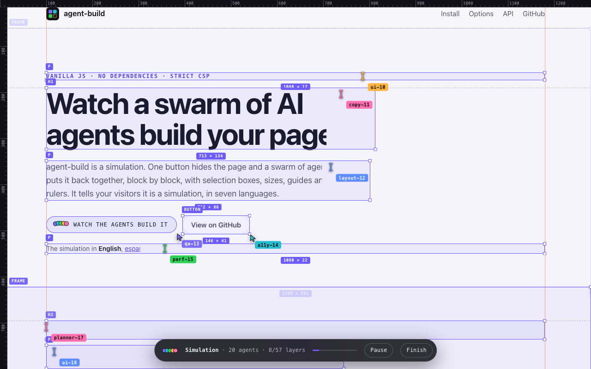

<div align="center">


# 🧱 agent-build

*A simulated swarm of AI agents rebuilds your page, block by block.*

[](https://github.com/magnoscg/agent-build/releases/latest)
[](https://www.npmjs.com/package/@magnoscg/agent-build)
[](https://github.com/magnoscg/agent-build/actions/workflows/ci.yml)
[](https://github.com/magnoscg/agent-build/stargazers)
[](LICENSE)
[](https://magnoscg.github.io/agent-build/)

**The simulation in**
[English](https://magnoscg.github.io/agent-build/?lang=en) ·
[español](https://magnoscg.github.io/agent-build/?lang=es) ·
[français](https://magnoscg.github.io/agent-build/?lang=fr) ·
[Deutsch](https://magnoscg.github.io/agent-build/?lang=de) ·
[italiano](https://magnoscg.github.io/agent-build/?lang=it) ·
[Nederlands](https://magnoscg.github.io/agent-build/?lang=nl) ·
[português](https://magnoscg.github.io/agent-build/?lang=pt) ·
[svenska](https://magnoscg.github.io/agent-build/?lang=sv)

One button hides the page, and a swarm of agent cursors puts it back together
with selection boxes, sizes, guides, rulers and a HUD that tells your visitors
it is a simulation. Vanilla JavaScript and CSS with no runtime dependencies,
at home under a strict Content Security Policy.

</div>



## At a glance

| | |
|---|---|
| Package | `@magnoscg/agent-build` on npm and jsDelivr, MIT |
| Entries | `@magnoscg/agent-build`: ES module, typed, no side effects, safe on a server. `@magnoscg/agent-build/auto`: mounts the buttons. `@magnoscg/agent-build/agent-build.css`: the stylesheet. `dist/agent-build.js`: classic script |
| Markup | `<button data-agent-build hidden></button>` or `<agent-build-button>` |
| Global | `window.AgentBuild`: `start`, `stop`, `isRunning`, `mount`, `addLocale`, `version` |
| Options | `data-agent-pace`, `-count`, `-accent`, `-hub`, `-frames`, `-atoms`, `-pop`, or the same names in `start()` |
| Events | `agentbuild:start` and `agentbuild:end` on `document` |
| Languages | `de`, `en`, `es`, `fr`, `it`, `nl`, `pt`, `sv`, and any other through `addLocale()` |
| Promises | It always says "Simulation". It never runs under reduced motion. The button ships hidden. No `innerHTML`, no `eval`, no inline styles. |
| Browsers | Chrome, Edge, Firefox and Safari from 2022 on |

## Contents

- [For AI agents](#for-ai-agents)
- [Quick start](#quick-start)
- [Install](#install)
- [Recipes](#recipes): [any bundler](#any-bundler), [React](#react), [Next.js](#nextjs), [Vue and Nuxt](#vue-and-nuxt), [Svelte and SvelteKit](#svelte-and-sveltekit), [Astro](#astro), [WordPress](#wordpress)
- [Options](#options)
- [API](#api)
- [How it works](#how-it-works)
- [Accessibility](#accessibility)
- [Security](#security)
- [Browser support](#browser-support)
- [Architecture](#architecture)
- [Development](#development)
- [Contributing](#contributing)
- [Credits](#credits)

## For AI agents

To add agent-build to a page you only need one of two parts of this file:
[Quick start](#quick-start) or [self-hosted](#install) for a page whose HTML you
write, or your framework's [recipe](#recipes). [Options](#options) if you want
to tune it. The same summary, without the rest, is in
[`llms.txt`](https://magnoscg.github.io/agent-build/llms.txt), which the package
also ships at `node_modules/@magnoscg/agent-build/llms.txt`.

- Keep `hidden` on the button, and leave its click to the library.
- Load the stylesheet too: without it the button stays hidden, on purpose.
- It always says "Simulation": `addLocale()` refuses texts that don't.

To change the library itself, read [AGENTS.md](AGENTS.md).

## Quick start

```html
<link rel="stylesheet" href="https://cdn.jsdelivr.net/npm/@magnoscg/agent-build@1.0.5/dist/agent-build.css" integrity="sha384-J3anTvh/g0WSEA3rC4XfzhJIT7FPIs0/eC7Fb0G2Fku3wOElf/9B/VuiuO/LP9fc" crossorigin="anonymous">
<script src="https://cdn.jsdelivr.net/npm/@magnoscg/agent-build@1.0.5/dist/agent-build.js" integrity="sha384-uleOa/pj2l/cn+ieGEYqYklZZxWA4VkPTryjz3wTtkHdQCsYitkvf3ec7o7BLfrg" crossorigin="anonymous" defer></script>
<button data-agent-build hidden></button>
```

That is all. The script shows the button, labels it in the page's language,
gives it a default look and runs the simulation on click. Put it wherever you
like: the hero, the footer, an easter egg.

The button ships `hidden` on purpose, so don't remove the attribute: the script
does, once the stylesheet has loaded and the browser can play the simulation.
Without it the button would show before that, even where it can never run. It
never appears for visitors who prefer reduced motion.

## Install

**From a CDN.** The snippet above. The `integrity` hashes make the browser
refuse anything but these exact files, so a compromised CDN cannot serve you
something else. They change with every version: take the snippet from the
README of the version you use.

**Self-hosted.** The library is two files from `dist/`, a script and a
stylesheet. Copy them from the npm package, or download them from the assets of
a [GitHub release](https://github.com/magnoscg/agent-build/releases), to any
folder your site serves:

```sh
pnpm add @magnoscg/agent-build
mkdir -p public/vendor
cp node_modules/@magnoscg/agent-build/dist/agent-build.min.js node_modules/@magnoscg/agent-build/dist/agent-build.min.css public/vendor/
```

```html
<link rel="stylesheet" href="/vendor/agent-build.min.css">
<script src="/vendor/agent-build.min.js" defer></script>
<button data-agent-build hidden></button>
```

| Files | When |
|---|---|
| `dist/agent-build.min.js`, `dist/agent-build.min.css` | On a live site, if nothing else minifies them: they do the same and weigh less |
| `dist/agent-build.js`, `dist/agent-build.css` | To read or debug them, or when your own build minifies them |

These need no `integrity`, which guards files from someone else's server, and
under a Content Security Policy `'self'` covers both.

**From npm.**

```sh
pnpm add @magnoscg/agent-build
```

```js
import { mount, start, stop } from '@magnoscg/agent-build';
import '@magnoscg/agent-build/agent-build.css';
```

The main entry has no side effects, so it is safe to import during server-side
rendering, where `start()` returns `false`. `import '@magnoscg/agent-build/auto'`
does what the `<script>` tag does: it defines `window.AgentBuild` and
`<agent-build-button>`, and mounts the `[data-agent-build]` buttons. Both
entries share one run.

## Recipes

Each recipe is one button and one import. The library listens for clicks on
the document, so none of them needs a click handler.

In apps that render on the server, give the button its own text and call
`mount()` once the component is on the page. Then the library only shows the
button and adds nothing to the markup your framework owns, so hydration finds
what the server sent.

### Any bundler

Vite, webpack, Parcel or esbuild, on a page you render yourself:

```html
<button data-agent-build hidden></button>
```

```js
import '@magnoscg/agent-build/agent-build.css';
import '@magnoscg/agent-build/auto';
```

### React

```jsx
import { useEffect } from 'react';
import { mount } from '@magnoscg/agent-build';
import '@magnoscg/agent-build/agent-build.css';

export function AgentBuildButton() {
  useEffect(() => {
    mount();
  }, []);

  return (
    <button data-agent-build="" data-agent-count="12" hidden>
      Watch the agents build it
    </button>
  );
}
```

To pass options from your code, give the same button a handler that starts
the run. It runs before the library's listener and wins the click:

```jsx
import { start } from '@magnoscg/agent-build';

<button data-agent-build="" hidden onClick={(event) => start({ trigger: event.currentTarget, count: 3 })}>
  Watch three agents build it
</button>;
```

### Next.js

The React component above, marked as a client component:

```jsx
'use client';

import { useEffect } from 'react';
import { mount } from '@magnoscg/agent-build';
import '@magnoscg/agent-build/agent-build.css';

export function AgentBuildButton() {
  useEffect(() => {
    mount();
  }, []);

  return <button data-agent-build="" hidden>Watch the agents build it</button>;
}
```

Don't import `@magnoscg/agent-build/auto` at the top of a client component:
it runs as soon as the bundle loads and would show the button before React
hydrates it.

### Vue and Nuxt

```vue
<script setup>
import { onMounted } from 'vue';
import { mount } from '@magnoscg/agent-build';
import '@magnoscg/agent-build/agent-build.css';

onMounted(() => mount());
</script>

<template>
  <button data-agent-build data-agent-count="12" hidden>Watch the agents build it</button>
</template>
```

### Svelte and SvelteKit

`mount` is renamed because Svelte has its own:

```svelte
<script>
  import { onMount } from 'svelte';
  import { mount as mountAgentBuild } from '@magnoscg/agent-build';
  import '@magnoscg/agent-build/agent-build.css';

  onMount(() => mountAgentBuild());
</script>

<button data-agent-build data-agent-count="12" hidden>Watch the agents build it</button>
```

### Astro

Astro sends plain HTML, so the auto entry can label and show the button:

```astro
---
import '@magnoscg/agent-build/agent-build.css';
---

<button data-agent-build hidden></button>

<script>
  import '@magnoscg/agent-build/auto';
</script>
```

With `<ClientRouter />`, mount the buttons of every page it navigates to:

```js
import { mount } from '@magnoscg/agent-build';

document.addEventListener('astro:page-load', () => mount());
```

### WordPress

Copy `agent-build.js` and `agent-build.css` into an `agent-build` folder of
your theme, enqueue them from its `functions.php` (WordPress 6.3 or later),
and put `<button data-agent-build hidden></button>` in a Custom HTML block or
a template:

```php
add_action('wp_enqueue_scripts', function () {
    $uri = fn ($file) => get_theme_file_uri("agent-build/$file");
    $version = fn ($file) => filemtime(get_theme_file_path("agent-build/$file"));
    wp_enqueue_style('agent-build', $uri('agent-build.css'), [], $version('agent-build.css'));
    wp_enqueue_script('agent-build', $uri('agent-build.js'), [], $version('agent-build.js'), ['strategy' => 'defer']);
});
```

## Options

Set them as data attributes on the button, or pass them to `start()`, which
wins over the attributes.

| Attribute | Option | Default | What it does |
|---|---|---|---|
| `data-agent-pace` | `pace` | `1` | Multiplies every duration, from 0.25 to 4. `2` is twice as slow. |
| `data-agent-count` | `count` | `20`, or `14` under 720 px | How many agents, from 1 to 40. |
| `data-agent-accent` | `accent` | `#7C6BFF` | Any CSS colour, for boxes, guides and the progress bar. |
| `data-agent-hub` | `hub` | Four blocks, inline SVG | URL of the icon the agents fly out of, usually your logo, drawn at 32 × 32 px. It can be relative to the page. An SVG needs a `viewBox` or a `width` and `height`. |
| `data-agent-frames` | `frames` | `header, footer, section, article, aside` | Selector for boxes: their box is revealed first, their content later. |
| `data-agent-atoms` | `atoms` | Headings, `p`, `li`, `dt`, `dd`, `blockquote`, `pre`, media, `table`, links, buttons and form controls | Selector for blocks revealed whole. |
| `data-agent-pop` | `pop` | Media, buttons, form controls, `.button`, `.btn`, `[role="button"]` | Selector for the blocks that fade in instead of being typed. |

```html
<button data-agent-build data-agent-pace="1.5" data-agent-count="12"
        data-agent-accent="#0A84FF" data-agent-hub="/logo.svg" hidden></button>
```

A broken selector or colour falls back to the default with a console warning,
and numbers are clamped, so a typo never breaks the page.

### Styling

- `data-agent-accent` colours one button and the runs it starts, and wins over
  everything but `start({ accent })`. Use it when the colour belongs to that
  button.
- `--agent-accent` on `:root` colours every button and run on the page. Use it
  when the colour comes from your theme, as in a dark mode. Set on a button in
  your CSS it only changes that button's look, because the run's overlays don't
  live inside the button.
- `--agent-mono` sets the monospace font of the labels and the HUD, also on
  `:root`.
- A trigger without a `class` attribute takes the default look. Give it your
  own classes and it is yours to style; add `agent-build-button` next to them
  to keep the default. The default look lives in the `agent-build` cascade
  layer, so any rule of your page wins over it.
- The five agent dots are available for your own button:
  `<span class="agent-build-dots" aria-hidden="true"><i></i><i></i><i></i><i></i><i></i></span>`.
  They hop in a wave while the button is hovered or focused, unless the
  visitor prefers reduced motion.

## API

The same functions are on `window.AgentBuild` and in the ES module:

```js
AgentBuild.start(options) // true if a run started
AgentBuild.stop()         // true if a run was stopped
AgentBuild.isRunning()    // true while a run is in progress
AgentBuild.mount(root)    // shows the [data-agent-build] triggers in root, the document by default
AgentBuild.addLocale(tag, texts) // adds or replaces a language
AgentBuild.version        // "1.0.5"
```

The module also exports `defineElement()` and the types:

```ts
import { addLocale, defineElement, isRunning, mount, start, stop, version } from '@magnoscg/agent-build';
import type { EndDetail, Locale, Options, StartDetail, StartOptions } from '@magnoscg/agent-build';
```

- `start(options)` takes the options above plus `trigger`, the element whose
  data attributes and language it reads; without one it reads the first
  `[data-agent-build]` on the page. It returns `false`, and does nothing, when
  a run is already in progress, the visitor prefers reduced motion, the
  browser lacks Web Animations or cascade layers, or the stylesheet is not
  loaded.
- `mount(root)` shows the triggers in `root` that can run, once each, so it is
  safe to call after every render. A trigger stays `hidden` without the
  stylesheet, without cascade layers or Web Animations, and under reduced
  motion. One click listener on the document serves every trigger, present or
  future, and runs after your own handlers: a handler that calls `start()` or
  `preventDefault()` wins the click.
- `defineElement(name)` defines the custom element, `agent-build-button` by
  default. The `<script>` tag and the auto entry already do it.

### Events

Both are dispatched on `document` and bubble to `window`.

| Event | When | `event.detail` |
|---|---|---|
| `agentbuild:start` | Before anything is measured or hidden | `{ trigger }`, the one pressed or passed to `start()`, else `null` |
| `agentbuild:end` | Once the page is back, however the run ended | `{ skipped, built, total, seconds }` |

`agentbuild:start` is the place to put scroll-reveal effects in their final
state. The library waits for the transitions they start, up to a second and
a half, so the agents measure the page as it really looks:

```js
document.addEventListener('agentbuild:start', () => {
  for (const element of document.querySelectorAll('[data-reveal]')) {
    element.classList.add('is-revealed');
  }
});
```

### Custom element

```html
<agent-build-button label="Watch the agents build it" data-agent-count="12"></agent-build-button>
```

It renders a `<button data-agent-build>` inside itself whenever it enters the
document and passes on its `data-agent-*` options. Without a `label` it uses
the default one in the page's language. In an app that renders on the server,
call `defineElement()` after hydration, as the recipes call `mount()`.

### Languages

The HUD, the button's default label and the announcements follow the nearest
`lang` attribute of the trigger, matched by subtags: `pt-BR` gets `pt`,
`es-MX` gets `es`. Any other language gets English, and the label says so in
its own `lang`.

| Tag | Language | Word for "Simulation" |
|---|---|---|
| `de` | Deutsch | Simulation |
| `en` | English | Simulation |
| `es` | español | Simulación |
| `fr` | français | Simulation |
| `it` | italiano | Simulazione |
| `nl` | Nederlands | Simulatie |
| `pt` | português | Simulação |
| `sv` | svenska | Simulering |

`addLocale()` adds a language, or replaces one, at any time: the labels the
library gave its triggers follow. It throws unless the label and both
announcements open with the language's `kicker`, its word for "Simulation",
and the summary says it. A shipped language, or a regional variant of one such
as `es-ES`, has to keep the word in the table. `agents` holds a form per
plural category of the language, as `Intl.PluralRules` names them, and always
`other`. Add `dir: 'rtl'` for a right-to-left language.

```js
import { addLocale } from '@magnoscg/agent-build';

addLocale('ca', {
  kicker: 'Simulació',
  label: "Simulació: agents d'IA construint la pàgina",
  cta: 'Mira com els agents construeixen la pàgina',
  agents: { one: '{count} agent', other: '{count} agents' },
  layers: '{done}/{total} capes',
  pause: 'Pausa',
  resume: 'Continua',
  finish: 'Acaba',
  started: "Simulació en curs: un eixam d'agents d'IA està construint la pàgina. Prem Esc per acabar.",
  built: 'Construïda en {seconds} s · era una simulació',
  finished: 'Simulació acabada. La pàgina està completa.',
});
```

To ship a language with the library, see [CONTRIBUTING.md](CONTRIBUTING.md#adding-a-language).

## How it works

A run goes through four steps:

1. **Start.** `agentbuild:start` fires while the page is untouched.
2. **Measure.** The page stays visible while the library waits for web fonts
   and finite transitions, up to a second and a half, then picks the blocks.
3. **Build.** The page is hidden with `visibility`, which keeps the layout
   still. The agents fly out of the hub, draw a box around each block and
   reveal it: frames fade in, text is typed, media and controls pop in. The
   page follows the work until the visitor scrolls.
4. **Finish.** Everything is shown, the overlays fade out, focus and scroll go
   back where they were, and `agentbuild:end` fires.

Every element under `<body>` is one of these, in document order:

- A **frame** matches `frames`, or paints a box of its own (a background, a
  shadow or a border all round), or holds loose text next to other blocks. Its
  box is revealed first and it is looked inside; what it holds waits for it,
  then gets built part by part.
- An **atom** matches `atoms`, or holds loose text, or is an SVG, a MathML
  formula or a component with a shadow root. It is revealed with everything
  inside it, which is how nested matches are deduplicated: a link inside a
  paragraph is part of the paragraph. A link that wraps blocks, the usual
  card, counts as a frame. A block that holds media and no text, like a link
  around a screenshot or a store badge, is labelled as its media and fades in.
- Whatever no layer covers, such as an icon-font glyph or a component with a
  closed shadow root, and whatever is fixed to the window, is shown as it is
  rather than hidden: right away, or together with its frame.
- What the page hides itself stays hidden, during the run and after.

A run builds for about twenty seconds, pauses aside, whatever the pace and
count; then the rest of the page appears at once. Each block is measured again
when its agent takes it, so fonts, images or transitions that move things
cannot leave a box behind, and a turned element gets a box of its own size and
angle. When the page scrolls an inner container instead of
the document, the blocks in view are built and the rest is shown as it is.

The run's state lives in attributes of its own, `data-agent-build-run` on
`<html>` and `data-agent-build-reveal` on the revealed blocks, never in your
classes, so a framework that rewrites `class` cannot undo it.

## Accessibility

- It says what it is. The HUD opens with the word for "Simulation", and the
  screen reader announcements at the start and the end do too, in every
  language it ships or accepts.
- Under `prefers-reduced-motion: reduce` the button never appears, `start()`
  refuses to run, and a run in progress stops if the preference changes.
- When a run starts, focus moves to the HUD's Pause button, whose label says
  what it does next: Pause or Resume. Escape finishes at any time. At the end,
  focus returns to where it was, or to the trigger, and the page scrolls back
  to where the visitor was, unless they scrolled during the run.
- The HUD and the announcements carry their own `lang` and `dir`. The live
  region is in place from the start of the run, so the first announcement is
  heard. Right-to-left text is typed from the right.
- It never rewrites content. It hides blocks with `visibility` and reveals
  them with Web Animations, so the layout never shifts. Hidden content is
  hidden from assistive technology too while the run lasts, which is why the
  run is short, announced, and can be stopped at once.
- The overlays (cursors, boxes, rulers) are `aria-hidden`. Only the HUD and
  its two buttons are exposed.

## Security

- **No inline styles.** Dynamic styles go through the CSSOM and Web
  Animations, which `style-src` does not restrict, so `style-src 'self'` is
  enough without `'unsafe-inline'`.
- **No HTML strings.** Every node is built with `createElement`, never
  `innerHTML`, and there is no `eval`. It runs with
  `require-trusted-types-for 'script'` and no Trusted Types policy at all.
- **CDN or self-hosted.** From jsDelivr, allow `https://cdn.jsdelivr.net` in
  `script-src` and `style-src`, and keep the `integrity` attributes.
  Self-hosted, `'self'` covers both.
- **Images.** The default hub icon is inline SVG, so `img-src` never needs
  `data:`. A `data-agent-hub` URL has to be allowed by your `img-src`.
- **Configuration is yours.** Treat the `data-agent-*` attributes as code:
  write them in your templates, never from content your visitors or third
  parties control. `data-agent-hub` makes the browser fetch a URL, and the
  selectors run against your whole page.

The demo page runs under `default-src 'self'; script-src 'self'; style-src
'self'; img-src 'self'; require-trusted-types-for 'script'; trusted-types
'none'`, and the browser smoke test fails on any CSP violation. To report a
vulnerability, see [SECURITY.md](SECURITY.md).

## Browser support

Current Chrome, Edge, Firefox and Safari, from 2022 on: the hiding relies on
cascade layers. Where cascade layers or Web Animations are missing, the
button simply stays hidden. The HUD and the top ruler go to the top layer
through the Popover API where it exists (2024 on), out of reach of the page's
stacking contexts. The automated smoke test runs in Chrome; Safari and Firefox
are not tested automatically yet.

## Architecture

The source is TypeScript in `src/`, built with esbuild into `dist/`, which is
not committed.

| Path | What lives there |
|---|---|
| `src/index.ts` | The public API, free of side effects |
| `src/auto.ts` | The `<script>` and `/auto` entry: `window.AgentBuild`, the custom element, mounting |
| `src/mount.ts` | Showing and labelling triggers, the click listener, `addLocale()` |
| `src/element.ts` | `<agent-build-button>` |
| `src/options.ts` | Defaults, limits and validation of every option |
| `src/locales/` | One data file per language, and the registry that resolves and checks them |
| `src/layers.ts` | Which elements become layers, as pure functions |
| `src/geometry.ts` | Where a block is: its box in document coordinates, turned with the element |
| `src/page.ts` | Feature checks and the attributes that hold a run's state |
| `src/run/` | A run: `run.ts` drives it, `build.ts` puts the agents to work, `reveal.ts`, `stage.ts` (overlays), `hud.ts`, `follow.ts` (scrolling and keys), `animate.ts` |
| `src/agent-build.css` | Hiding, revealing, the overlays and the default button, in the `agent-build` cascade layer |
| `scripts/` | Build, demo server, smoke test, integrity hashes and release helpers |
| `test/` | `unit/` on the source, `dist/` on the build, `release/` on the snippets, `fixtures/` for the smoke test |

## Development

Node 24 or later and pnpm 11.

```sh
pnpm install       # TypeScript, esbuild and playwright-core
pnpm typecheck     # tsc, strict
pnpm test:unit     # node --test on src/ directly
pnpm build         # dist/: classic script, ES modules, stylesheet and types
pnpm test:dist     # the built files: exports, Node ESM imports, TypeScript consumers
pnpm smoke         # the real library in your installed Chrome, sandboxed
pnpm demo          # the demo at http://127.0.0.1:4173/
pnpm test:release  # the snippets' version and integrity hashes, before a release
```

CI runs everything but the smoke test, on Node 24 and 26; the smoke test needs
Google Chrome installed and runs locally.

## Contributing

Issues and pull requests are welcome. [CONTRIBUTING.md](CONTRIBUTING.md) has
the workflow, and [AGENTS.md](AGENTS.md) the map of the repository and the
rules a change must keep, written for people and coding agents alike. See
also the [changelog](CHANGELOG.md) and the [code of conduct](CODE_OF_CONDUCT.md).

## Credits

Inspired by [swarm-site](https://califa.github.io/swarm-site/) and a video by
[@EHuanglu](https://x.com/EHuanglu) on X. No code was taken from either:
agent-build is an original implementation, first written for
[ogamlabs.com](https://ogamlabs.com).

## License

[MIT](LICENSE) © 2026 Oscar Canton
